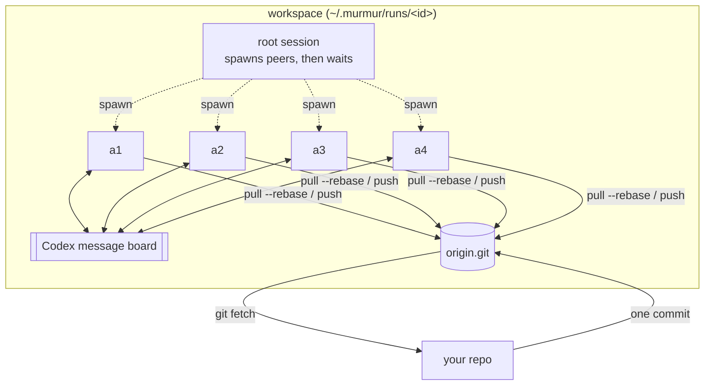

# murmur

Run a leaderless swarm of [Codex](https://github.com/openai/codex) agents on one objective.

`murmur` gives N Codex agents the same brief and the same authority. They share a private git
remote and Codex's built-in message board, divide the work among themselves, integrate through
git, and stop when they agree they are done. No agent is in charge. You get the result as a
branch to review.

```bash
murmur setup brief.md --repo . --peers 4 --setup "npm ci"
murmur run ~/.murmur/runs/3f9a1c2e
git fetch ~/.murmur/runs/3f9a1c2e/work/origin.git main:murmur/3f9a1c2e
```

## How it works



`murmur setup` copies one commit of your repo into a bare `origin.git` and makes a clone per agent.
It runs your setup commands once in the first clone, then copy-on-write copies that tree for the
other agents. It renders a prompt per agent: your brief, shared rules, and that agent's identity
and port range.

`murmur run` starts one `codex exec` session. Its root only spawns the peers through Codex's
Multi-Agent V2 tools and waits for them. Each peer starts with a fresh conversation and reads
its own complete instruction file; the launcher history is not copied into every peer. The peers
work in four moves:

1. **Shared tools:** one peer builds a way to run and capture the result without credentials.
2. **Explore:** each peer claims a different direction for the parts that decide quality and
   builds a quick draft of it on `draft/<id>`, without looking at the others first. Peers of one
   model with one brief think alike; separate drafts give the swarm real alternatives, which a
   single agent never has.
3. **Choose by looking:** every peer captures every draft and ranks them; the draft ranked first
   most often becomes the base.
4. **Build and review:** the peers plan the whole result in `PR.md`, claim parts on the message
   board (by convention a `tasks` channel where the earliest claim wins, and a `findings`
   channel) and push to `main`. Each peer ends its turn only after reviewing the integrated
   `main` and finding nothing worth fixing.

The run ends when no peer is running, or at the time cap. On the way out, including success,
failure, the cap, and interruption, murmur signals the Codex process group: `SIGTERM`, then
`SIGKILL` if any member is still alive.

Two peers are the default because the prior [peer-count experiments](research/evidence/lean2-RESULTS.md)
showed lower input usage with two peers than with three. Those small experiments do not establish
a general speedup, equal quality, or a fixed token ratio; `--peers` remains configurable.

`murmur setup --solo` builds the same isolated workspace for a single agent, as a baseline.

## Install

Requires Python 3.11+, git, and Codex CLI 0.162 or later, logged in.

```bash
uv tool install --editable .   # or: pipx install .
```

## Usage

```text
murmur setup BRIEF [--repo DIR] [--base REF] [--peers N | --solo] [--setup CMD]...
                   [--setup-per-agent]
                   [--model M] [--effort E] [--cap 3h] [--port-base N]
                   [--into DIR] [--id ID] [--config FILE] [--max-file-mb N]
murmur run WORKSPACE
```

| Option | Default | Notes |
|--------|---------|-------|
| `BRIEF` | — | Markdown with the objective. The agents cannot ask questions; they record their decisions in `PR.md`. |
| `--repo` | current repo | Agents start from one commit; uncommitted changes are not included. A plain folder also works (see below) |
| `--max-file-mb` | see `--help` | Plain-folder input only: larger files are shared read-only links instead of git content |
| `--base` | `HEAD` | Commit or ref to start from |
| `--peers` / `--solo` | 2 peers | Start with two; increase explicitly when the task has enough independent work |
| `--setup` | none | Shell command run once, in the first clone, before the clock starts (repeatable) |
| `--setup-per-agent` | off | Run `--setup` in every clone. Use this when the install embeds absolute paths |
| `--cap` | `3h` | Hard time limit, e.g. `90m` |
| `--port-base` | `40000` | Each agent gets 100 ports. Shells started in its clone export `PORT_BASE` |
| `--config` | none | TOML with any of the above, plus `setup_per_agent` and `agent_env` templates (`$agent`, `$index`, `$port_base`, `$run`). Flags override it. |

`murmur run` prints how long the run took, how many commits it made, and the `git fetch` command.
A non-zero exit also prints a short diagnostic and the log path (`logs/session.err`). `PR.md` at
the root of the result is the agents' summary.

`logs/run.json` also inventories the delivered `origin/main` revision: new commits,
changed paths, presence of `PR.md`, and whether each peer's local HEAD is included in
that revision or has tracked edits. Missing repositories produce unknown fields and
errors. Untracked files are not inventoried, and setup or discarded drafts can leave
intentional local changes. These are delivery diagnostics, not a verdict that the
objective is complete; they do not change the documented exit codes.

| Code | Meaning |
|------|---------|
| 0 | Codex exited 0 |
| 1 | Codex exited non-zero |
| 3 | Launcher error (bad arguments, setup failed, workspace already run or missing) |
| 124 | The time cap was reached |
| 130 | Interrupted (`SIGINT` / `SIGTERM` / `SIGHUP`) |

Argparse usage errors still exit 2, so the time cap does not use that code. The fetch command is
printed whenever `origin.git` exists.

### Plain-folder input

`--repo` may be a folder that is not a git repository. murmur snapshots it into the run's
private repository and never writes to the folder:

- files ignored by its `.gitignore` or your global git ignore file (for example `node_modules/`,
  build output, `.DS_Store`) are left out;
- executable bits and symlinks are kept;
- a nested git repository (`sub/.git`) comes in as its tracked and untracked files, without its
  `.git` history;
- files over `--max-file-mb` are not committed: each clone gets a read-only link to one shared
  copy, so large data costs no copy time or disk.

When the run ends, `murmur run` writes the result to a new sibling folder,
`<folder>.murmur-<id>`, and prints its path. It is written under a temporary name and renamed
when complete, so a failure leaves no partial folder (the result stays in the run's `origin.git`). Large files are filled in there as real files, and
the agents' `.work/` scratch is left out. The source folder is never changed; compare the two and
copy over what you want.

### Copy-on-write setup

Setup runs in the first clone, then copies that tree:

- macOS: `cp -c -R` (APFS clonefile)
- Linux: `cp --reflink=always -R` (btrfs or xfs)

The copy is never retried as a plain `cp`. If reflink fails, murmur deletes the partial tree,
keeps the first clone, and runs setup in the remaining clones in parallel. Each copy's git
identity, origin URL, and config values that still point at the first clone are rewritten.

That rewrite does not cover the installed tree. Copied clones can keep absolute paths to the
first clone, for example pnpm shims that hard-code `NODE_PATH` to `a1`'s `node_modules`. Use
`--setup-per-agent` when the install embeds absolute paths (virtualenvs, node shebangs, compiled
prefixes).

Shared setup does not receive per-agent `PORT_BASE` or `agent_env`, so those values are not baked
into a tree that is then copied. `ZDOTDIR` points at `<workspace>/zdot`, whose `.zshenv` loads
`<clone>/.murmur/env.sh` when the shell's physical path (`pwd -P`) is inside that clone. Commands
that start outside the clone, such as in `work/`, do not get those values. The prompt tells each
agent to export them there. `HOME` is unchanged.

Setup inherits the environment you launched murmur with, including your pnpm store, so a later
run can reuse packages already downloaded. The run does not point pnpm at a store outside `work/`.
Inside the sandbox, pnpm falls back to a store inside the project.

## Isolation

- Each agent works in its own clone; the only remote is the workspace's `origin.git`.
  Force-pushes and branch deletions are refused.
- Agents have network access. GitHub git URLs (`https://github.com/`, `git@github.com:`,
  `ssh://git@github.com/`) are rewritten to a dead path, and `gh` has an empty config directory.
  That is not a network block: `curl https://github.com` can succeed.
- Agent shells use Codex's core environment. `ZDOTDIR` is `<workspace>/zdot`, so zsh does not read
  your dotfiles. `HOME` stays your home directory.
- Each run gets its own `CODEX_HOME` with only your model provider and auth: no plugins, memories,
  personal instructions or past sessions.

This prevents accidents, not a determined agent: the Codex sandbox can still read your disk. For
strict isolation, run murmur as a separate OS user.

## Workarounds murmur applies to Codex 0.162

- **`--disable multi_agent` does not remove `spawn_agent` for models whose catalog entry forces
  Multi-Agent V2** ([openai/codex#50880](https://github.com/openai/codex/issues/50880)). For
  `--solo`, murmur writes a per-run model catalog with `multi_agent_version` cleared.
- **Sub-agents run at the catalog's `multi_agent_reasoning_effort`** (`xhigh` for `gpt-6-astra`),
  not at the session's. The per-run catalog pins it to `--effort`.
- **A null catalog `tool_mode` makes the message board fail.** Codex then sends
  `collaboration.create_channel` and the other board tools as namespaced functions, and the
  backend rejects them (`Function 'collaboration.create_channel' is not allowed in reserved
  namespace 'collaboration'`). For a swarm, murmur sets that model's `tool_mode` to
  `code_mode_only` when the catalog left it unset, so the model calls the board through `exec`.
  An explicit value is kept. Solo runs do not use the board, so their catalog is left alone.
- **Multi-Agent V2 allows 4 threads per session, counting the root**, so a fourth peer fails to
  spawn. murmur raises the limit to peers + 1.
- Sessions start in the workspace's `work/` directory, which is not a repository. That needs
  `--skip-git-repo-check`, and it keeps the repo's own Codex hooks from loading. The shared
  prompt sends every agent to its clone's `AGENTS.md`.

## What we have measured

The prior experiments include coding and plain-folder tasks, multiple peer counts, and held-out
validation. Two peers often used fewer tokens than three, but the favorable exploratory result
of 1.7–1.8× solo **uncached input** did not replicate: held-out lean2 runs used 4.4–4.6× solo
uncached input and failed the keep rule. Total input was higher still in many comparisons.
Speedups varied with the task; quality parity and a 1.5–2× **total-token** budget are unproven.
See the [research report](research/REPORT.md), [prior results](research/evidence/lean2-RESULTS.md),
and [held-out validation](research/evidence/val-RESULTS.md).

`murmur run` now adds two observations to `logs/run.json`:

- `usage`: per-thread and aggregate input, cached input, derived uncached input, output and
  observed response counts from this run's Codex rollouts. Duplicate response records are
  counted once; missing telemetry stays unknown. These are observed completed responses,
  not guaranteed complete API usage or a bill. The terminal prints a short usage summary.
- `result`: the delivered `origin/main` revision and peer worktree/integration state. This is
  delivery evidence, not a statement that the requested work is correct or complete.

The run remains reviewable after failure, a cap, or interruption. Exit codes keep their existing
meaning. No model pricing table or guessed active-time adjustment is applied.

## Tests

Tests use a fake `codex` executable and temporary git repositories. They do not call a model.

```bash
python -m pip install -e ".[test]"
pytest
```

Continuous integration builds the wheel on Linux and macOS, installs it in a clean virtualenv,
checks the `murmur` entry point and the packaged prompts, then runs the same suite.

## Status

Experimental. It depends on Codex features that are still marked under development (the agent
message board) and on behaviour of Codex 0.162.
