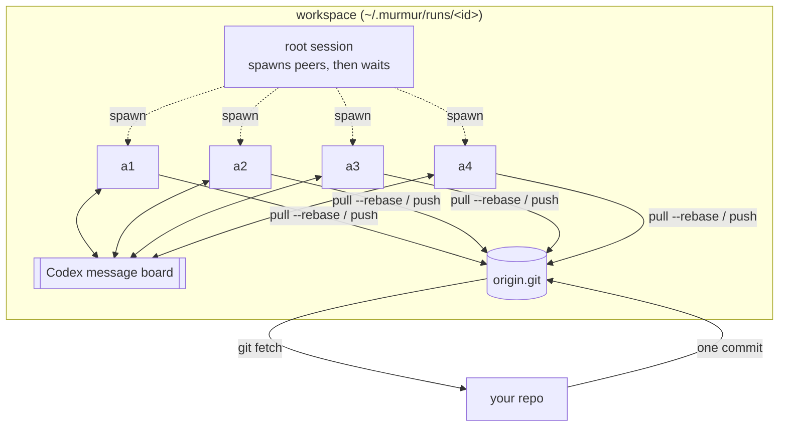

# murmur

Run a leaderless swarm of [Codex](https://github.com/openai/codex) agents on one objective.

`murmur` gives N Codex agents the same brief and the same authority. They share a private git
remote and Codex's built-in message board, divide the work among themselves, integrate through
git, and stop when they agree they are done. No agent is in charge. You get the result as a
branch to review.

```bash
murmur setup brief.md --repo . --peers 3 --setup "npm ci"
murmur run ~/.murmur/runs/3f9a1c2e
git fetch ~/.murmur/runs/3f9a1c2e/work/origin.git main:murmur/3f9a1c2e
```

**What it buys you, measured:** murmur trades tokens for wall-clock time. In the latest blind,
held-out evaluation, a 3-peer swarm finished in about **0.73×** the active time of a single Codex
agent, used about **4.1×** the input tokens, and did not beat it on quality: the mean score tied,
and on the runs where nobody failed outright the swarm scored about **0.5 points lower** (0–10
scale). See [What we have measured](#what-we-have-measured).

## When to use it

- **Use murmur** when finishing sooner matters more than tokens, on large work that splits into
  parts (a feature spanning API, UI, docs and tests; many independent changes), and you will
  review the result before merging anyway. The evaluated tasks took a single agent 26–67 active
  minutes.
- **Use one agent** when token cost matters, when you want the best typical quality, or for small
  or tightly coupled changes. A single agent scored higher on 5 of the 8 evaluated task runs, and
  the evaluation found no quality gain from the swarm.
- **Compare on your own task:** `murmur setup --solo` builds the same isolated workspace for one
  agent, so you can run both and look at the results side by side.

## How it works



`murmur setup` copies one commit of your repo into a bare `origin.git` and makes a clone per agent.
It runs your setup commands once in the first clone, then copy-on-write copies that tree for the
other agents. It renders a prompt per agent: your brief, shared rules, and that agent's identity
and port range.

`murmur run` starts one `codex exec` session. Its root only spawns the peers through Codex's
Multi-Agent V2 tools and waits for them. The peers work in four moves:

1. **Shared tools:** one peer builds a way to run and capture the result without credentials.
2. **Explore:** each peer claims a different direction for the parts that decide quality and
   builds a quick draft of it on `draft/<id>`, without looking at the others first. Peers of one
   model with one brief think alike; separate drafts give the swarm real alternatives, which a
   single agent never has.
3. **Choose by looking:** every peer captures every draft and ranks them; the draft ranked first
   most often becomes the base.
4. **Build and review:** the peers plan the whole result in `PR.md`, claim parts on the message
   board (by convention a `tasks` channel where the earliest claim wins, and a `findings`
   channel) and push to `main`. Each peer ends its turn only after reviewing the integrated
   `main` and finding nothing worth fixing.

The run ends when no peer is running, or at the time cap. On the way out, including success,
failure, the cap, and interruption, murmur signals the Codex process group: `SIGTERM`, then
`SIGKILL` if any member is still alive.

`murmur setup --solo` builds the same isolated workspace for a single agent, as a baseline.

## Install

Requires Python 3.11+, git, and Codex CLI 0.162 or later, logged in.

```bash
uv tool install --editable .   # or: pipx install .
```

The Python package is named `codex-swarm`, because `murmur` and `murmur-swarm` are already taken on PyPI. The command it installs is still `murmur`.

## Usage

```text
murmur setup BRIEF [--repo DIR] [--base REF] [--peers N | --solo] [--setup CMD]...
                   [--setup-per-agent]
                   [--model M] [--effort E] [--cap 3h] [--port-base N]
                   [--into DIR] [--id ID] [--config FILE] [--max-file-mb N]
murmur run WORKSPACE
```

| Option | Default | Notes |
|--------|---------|-------|
| `BRIEF` | — | Markdown with the objective. The agents cannot ask questions; they record their decisions in `PR.md`. |
| `--repo` | current repo | Agents start from one commit; uncommitted changes are not included. A plain folder also works (see below) |
| `--max-file-mb` | `50` | Plain-folder input only: larger files are shared read-only links instead of git content |
| `--base` | `HEAD` | Commit or ref to start from |
| `--peers` / `--solo` | 4 peers | The evaluation used 3 peers; peer counts have not been compared in a controlled test |
| `--setup` | none | Shell command run once, in the first clone, before the clock starts (repeatable) |
| `--setup-per-agent` | off | Run `--setup` in every clone. Use this when the install embeds absolute paths |
| `--model` | `gpt-6-astra` | Codex model. The swarm is tuned for this one |
| `--effort` | `high` | Reasoning effort, also pinned for the peers |
| `--cap` | `3h` | Running-time limit, e.g. `90m`; ticks more than 10 s late count as stalled |
| `--port-base` | `40000` | Each agent gets 100 ports. Shells started in its clone export `PORT_BASE` |
| `--into` | `~/.murmur/runs` | Parent directory for workspaces |
| `--id` | random | Workspace id |
| `--config` | none | TOML with any of the above, plus `setup_per_agent` and `agent_env` templates (`$agent`, `$index`, `$port_base`, `$run`). Flags override it. |

`murmur run` prints how long the run took, how many commits it made, and the `git fetch` command.
A non-zero exit also prints a short diagnostic and the log path (`logs/session.err`). `PR.md` at
the root of the result is the agents' summary.
`logs/run.json` records `active_seconds` and `stalled_seconds`; only running time counts against the cap.

| Code | Meaning |
|------|---------|
| 0 | Codex exited 0 and `main` in `origin.git` has new commits |
| 1 | Codex exited non-zero |
| 3 | Launcher error (bad arguments or config, setup failed, workspace missing, already run or still running) |
| 4 | No work delivered: Codex exited 0 but `main` did not advance. Any `draft/*` branches are listed with a fetch command |
| 124 | The running-time cap was reached |
| 130 | Interrupted (`SIGINT` / `SIGTERM` / `SIGHUP`) |

Argparse usage errors still exit 2, so the time cap does not use that code. The fetch command is
printed when `main` in `origin.git` has new commits, whatever the exit code. When it has none, murmur
prints no fetch command and instead lists any unmerged `draft/*` branches with a command that
fetches them to `murmur/<id>-drafts/*`.

### Preflight check and token report

```text
murmur doctor [--repo DIR] [--model M] [--into DIR] [--solo] [--config FILE]
```

`murmur doctor` prints one line per check, with a fix hint for anything that is not ok:

- the Codex CLI version (0.162 or later);
- the model is in `codex debug models`;
- Codex has the swarm features `agent_message_board` and `multi_agent_v2` (skipped with `--solo`);
- git, and the repo or plain folder;
- copy-on-write support and free space where workspaces go (`--into`);
- a Codex login exists: `auth.json`, your provider's `env_key` variable, or
  `CODEX_API_KEY`/`OPENAI_API_KEY`. It checks only that one exists and never reads its contents.

It exits 0 when no check failed and 1 otherwise. A missing copy-on-write filesystem and low disk
space are warnings, not failures: murmur still works, and runs `--setup` in every clone instead.

`murmur run` repeats the quick checks (Codex version, git, login) before it starts Codex. If one
fails it exits 3 with the hint, and the workspace can still be run once that is fixed.

At the end, `murmur run` prints the tokens the run used, in total and per agent (root and each
peer): input, of which cached, and output. `logs/run.json` records the same numbers under
`tokens`, summed from the Codex session logs in `codex-home/sessions/` (`null` when there are none).

Peers are meant to start without the launcher's conversation (see the workarounds below). If the
session logs show that Codex copied it into a peer anyway, `murmur run` says so on stderr and
`logs/run.json` counts those peers in `forked_peers`.

### Plain-folder input

`--repo` may be a folder that is not a git repository. murmur snapshots it into the run's
private repository and never writes to the folder:

- files ignored by its `.gitignore` or your global git ignore file (for example `node_modules/`,
  build output, `.DS_Store`) are left out;
- executable bits and symlinks are kept;
- a nested git repository (`sub/.git`) comes in as its tracked and untracked files, without its
  `.git` history;
- files over `--max-file-mb` are not committed: each clone gets a read-only link to one shared
  copy, so large data costs no copy time or disk.

When the run ends with new commits on `main`, `murmur run` writes the result to a new sibling
folder, `<folder>.murmur-<id>`, and prints its path. If nothing reached `main`, no folder is
written; murmur names the `draft/*` branches in the run's `origin.git` and prints a `git clone -b`
command for one. It is written under a temporary name and renamed
when complete, so a failure leaves no partial folder (the result stays in the run's `origin.git`). Large files are filled in there as real files, and
the agents' `.work/` scratch is left out. The source folder is never changed; compare the two and
copy over what you want.

### Copy-on-write setup

Setup runs in the first clone, then copies that tree:

- macOS: `cp -c -R` (APFS clonefile)
- Linux: `cp --reflink=always -R` (btrfs or xfs)

The copy is never retried as a plain `cp`. If reflink fails, murmur deletes the partial tree,
keeps the first clone, and runs setup in the remaining clones in parallel. Each copy's git
identity, origin URL, and config values that still point at the first clone are rewritten.

That rewrite does not cover the installed tree. Copied clones can keep absolute paths to the
first clone, for example pnpm shims that hard-code `NODE_PATH` to `a1`'s `node_modules`. Use
`--setup-per-agent` when the install embeds absolute paths (virtualenvs, node shebangs, compiled
prefixes).

Shared setup does not receive per-agent `PORT_BASE` or `agent_env`, so those values are not baked
into a tree that is then copied. `ZDOTDIR` points at `<workspace>/zdot`, whose `.zshenv` loads
`<clone>/.murmur/env.sh` when the shell's physical path (`pwd -P`) is inside that clone. Commands
that start outside the clone, such as in `work/`, do not get those values. The prompt tells each
agent to export them there. `HOME` is unchanged.

Setup inherits the environment you launched murmur with, including your pnpm store, so a later
run can reuse packages already downloaded. The run does not point pnpm at a store outside `work/`.
Inside the sandbox, pnpm falls back to a store inside the project.

## Isolation

- Each agent works in its own clone; the only remote is the workspace's `origin.git`.
  Force-pushes and branch deletions are refused.
- Agents have network access. GitHub git URLs (`https://github.com/`, `git@github.com:`,
  `ssh://git@github.com/`) are rewritten to a dead path, and `gh` has an empty config directory.
  That is not a network block: `curl https://github.com` can succeed.
- Agent shells use Codex's core environment. `ZDOTDIR` is `<workspace>/zdot`, so zsh does not read
  your dotfiles. `HOME` stays your home directory.
- Each run gets its own `CODEX_HOME` with only your model provider and auth: no plugins, memories,
  personal instructions or past sessions. A swarm's also has one hook, murmur's own (see the
  workarounds below); your own Codex hooks are not carried over.

This prevents accidents, not a determined agent: the Codex sandbox can still read your disk. For
strict isolation, run murmur as a separate OS user.

## Workarounds murmur applies to Codex 0.162

- **`--disable multi_agent` does not remove `spawn_agent` for models whose catalog entry forces
  Multi-Agent V2** ([openai/codex#50880](https://github.com/openai/codex/issues/50880)). For
  `--solo`, murmur writes a per-run model catalog with `multi_agent_version` cleared.
- **Sub-agents run at the catalog's `multi_agent_reasoning_effort`** (`xhigh` for `gpt-6-astra`),
  not at the session's. The per-run catalog pins it to `--effort`.
- **A null catalog `tool_mode` makes the message board fail.** Codex then sends
  `collaboration.create_channel` and the other board tools as namespaced functions, and the
  backend rejects them (`Function 'collaboration.create_channel' is not allowed in reserved
  namespace 'collaboration'`). For a swarm, murmur sets that model's `tool_mode` to
  `code_mode_only` when the catalog left it unset, so the model calls the board through `exec`.
  An explicit value is kept. Solo runs do not use the board, so their catalog is left alone.
- **Multi-Agent V2 allows 4 threads per session, counting the root**, so a fourth peer fails to
  spawn. murmur raises the limit to peers + 1.
- **`spawn_agent` copies the caller's whole conversation into the new agent** unless the call sets
  `fork_turns` to `"none"`, and no Codex setting changes that default. Each peer would then carry
  the launcher's instructions on every request and could take them for its own. The launcher's
  prompt asks for `"none"`. A model can ignore a prompt, so the swarm's `CODEX_HOME` also registers
  a `PreToolUse` hook (`<workspace>/hooks/spawn_hook.py`) that rewrites the launcher's
  `spawn_agent` calls to `fork_turns: "none"`. Codex runs a hook only after its user has approved
  it, so murmur records that approval for this one hook in the run's `config.toml`. A peer that
  spawns helpers of its own keeps Codex's default.
- Sessions start in the workspace's `work/` directory, which is not a repository. That needs
  `--skip-git-repo-check`, and it keeps the repo's own Codex hooks from loading. The shared
  prompt sends every agent to its clone's `AGENTS.md`.

## What we have measured

The numbers below come from the round-4 final report,
[`research-r4/FINAL-REPORT.md`](https://github.com/yctimlin/murmur/blob/experiment/self-improve-r4/research-r4/FINAL-REPORT.md)
on the `experiment/self-improve-r4` branch (written 2026-10-24), and its data in
`research-r4/results/FINAL.json`. The swarm arm there, `base4F` (a331d54), runs the same `src/`
code as `main` today.

**Setup.** 4 sealed tasks written by a separate author and never seen by the developer, 2 runs
each, so 8 runs per arm. Each run was large, open-ended design-and-build work. Swarms used 3 peers;
every run used `gpt-6-astra` at effort `high` with a 120-minute cap. A blind Claude judge scored
each delivered tree from 0 to 10 without knowing which arm produced it. A run that scored below 3
or delivered nothing counts as a collapse. Brackets are 90% confidence intervals.

| | Swarm (3 peers) | Solo Codex |
|---|---|---|
| Mean quality | 6.76 [6.31, 7.21] | 6.76 [5.46, 8.06] |
| Median quality | 6.97 | 7.58 |
| Collapses | 0 of 8 | 1 of 8 |
| Mean active minutes | 27.2 | 39.1 |
| Mean input tokens (uncached) | 12.2M (0.46M) | 3.1M (0.09M) |
| Mean output tokens | 0.10M | 0.06M |

Paired swarm-versus-solo contrasts over the 8 task runs:

- **Time:** active time ratio 0.73 [0.58, 0.91]. The swarm was faster.
- **Quality:** mean difference −0.004 [−0.99, +0.99]. The mean ties only because solo collapsed
  once. On the 7 task runs where nobody collapsed, the swarm was 0.49 lower [−0.92, −0.06].
- **Tokens:** input token ratio 4.12× [3.09, 5.49]. Most of it is cached input. The project's
  target was 1.5–2×.

Against the original murmur design (`origF`), the current one did not regress: +1.27 [−0.46, +3.00]
in quality and 0 collapses against 2, with about the same time (0.99×) and input tokens (1.09×).
Its gain is reliability, not speed or peak quality.

Round 4 also tried four new collaboration mechanisms on development tasks: consensus termination,
a shared spine with independent acceptance checks, a truthful budget clock with clean roles, and a
cross-verification ledger. None passed its pre-registered test against the design on `main` (the
ledger scored about 0.3 higher but took about 2.1× as long), so none was merged. The report's
diagnosis is that a healthy swarm spends 2.3–2.5× a single agent's agent-time for about 1.5× its
build time, mostly on verification duplicated across peers, on reading each other's work, and on
the draft-and-rank step. The extra tokens come mainly from peers re-reading each other's code in
large contexts, not from messaging.

**Limits.** Eight task runs per arm is a small sample, and the intervals are wide. There was one
judge family and one rubric. Judges guessed correctly whether a result came from one agent or a
team 74% of the time, so blinding was partial. Half of the solo runs took under the intended 40
active minutes. The VM was frozen for much of the wall time; active time excludes those freezes,
so do not read the wall-clock numbers in the report as speed.

Round 3 found the same trade with a larger quality gap. Its report
([`REPORT-r3.md`](https://github.com/yctimlin/murmur/blob/experiment/self-improve-r3/REPORT-r3.md))
measured 3-peer swarms at about 0.63× solo's active time and about 4× its input tokens, scoring
1.3–1.7 points lower. The very first pilot (one swarm run and one solo run on a UI feature,
46 versus 120 minutes) is superseded by these controlled results.

## Tests

Tests use a fake `codex` executable and temporary git repositories. They do not call a model.

```bash
python -m pip install -e ".[test]"
pytest
```

Continuous integration builds the wheel on Linux and macOS, installs it in a clean virtualenv,
checks the `murmur` entry point and the packaged prompts, then runs the same suite.

## Status

Experimental. It depends on Codex features that are still marked under development (the agent
message board) and on behaviour of Codex 0.162.

## Contributing

Bug reports, run reports and pull requests are welcome. See [CONTRIBUTING.md](CONTRIBUTING.md).

## License

[MIT](LICENSE)
