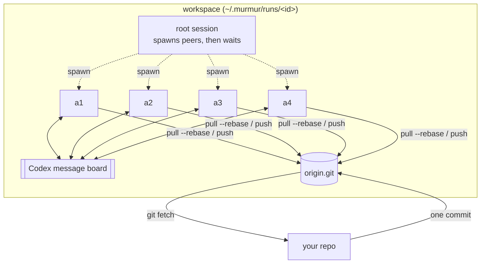

# murmur

Run a leaderless swarm of [Codex](https://github.com/openai/codex) agents on one objective.

`murmur` gives N Codex agents the same brief and the same authority. They share a private git
remote and Codex's built-in message board, divide the work among themselves, integrate through
git, and stop when they agree they are done. No agent is in charge. You get the result as a
branch to review.

```bash
murmur setup brief.md --repo . --peers 4 --setup "npm ci"
murmur run ~/.murmur/runs/3f9a1c2e
git fetch ~/.murmur/runs/3f9a1c2e/work/origin.git main:murmur/3f9a1c2e
```

## How it works



`murmur setup` copies one commit of your repo into a bare `origin.git` and makes a clone per agent.
It runs your setup commands in each clone, then renders a prompt per agent: your brief, shared
rules, and that agent's identity and port range.

`murmur run` starts one `codex exec` session. Its root only spawns the peers through Codex's
Multi-Agent V2 tools and waits for them. The peers work in four moves:

1. **Shared tools:** one peer builds a way to run and capture the result without credentials.
2. **Explore:** each peer claims a different direction for the parts that decide quality and
   builds a quick draft of it on `draft/<id>`, without looking at the others first. Peers of one
   model with one brief think alike; separate drafts give the swarm real alternatives, which a
   single agent never has.
3. **Choose by looking:** every peer captures every draft and ranks them; the draft ranked first
   most often becomes the base.
4. **Build and review:** the peers plan the whole result in `PR.md`, claim parts on the message
   board (by convention a `tasks` channel where the earliest claim wins, and a `findings`
   channel) and push to `main`. Each peer ends its turn only after reviewing the integrated
   `main` and finding nothing worth fixing.

The run ends when no peer is running, or at the time cap.

`murmur setup --solo` builds the same isolated workspace for a single agent, as a baseline.

## Install

Requires Python 3.11+, git, and Codex CLI 0.162 or later, logged in.

```bash
uv tool install --editable .   # or: pipx install .
```

## Usage

```text
murmur setup BRIEF [--repo DIR] [--base REF] [--peers N | --solo] [--setup CMD]...
                   [--model M] [--effort E] [--cap 3h] [--port-base N]
                   [--into DIR] [--id ID] [--config FILE]
murmur run WORKSPACE
```

| Option | Default | Notes |
|--------|---------|-------|
| `BRIEF` | — | Markdown with the objective. The agents cannot ask questions; they record their decisions in `PR.md`. |
| `--repo` | current repo | Agents start from one commit; uncommitted changes are not included |
| `--base` | `HEAD` | Commit or ref to start from |
| `--peers` / `--solo` | 4 peers | Two peers are often as good as four |
| `--setup` | none | Shell command run in every clone before the clock starts (repeatable) |
| `--cap` | `3h` | Hard time limit, e.g. `90m` |
| `--port-base` | `40000` | Each agent gets 100 ports, in its prompt and as `PORT_BASE` |
| `--config` | none | TOML with any of the above (`repo`, `brief`, `base`, `peers`, `setup`, `cap`, …), plus `agent_env` templates. Flags override it. |

`murmur run` prints how long the run took, how many commits it made, and the `git fetch` command
for the result. `PR.md` at the root of the result is the agents' summary.

## Isolation

- Each agent works in its own clone; the only remote is the workspace's `origin.git`.
  Force-pushes and branch deletions are refused.
- Agents have network access but cannot reach GitHub: an isolated git config with no credential
  helper rewrites GitHub URLs to a dead path, and `gh` has no login.
- Agent shells start from a minimal environment and an empty `ZDOTDIR`, so API keys exported by
  your shell dotfiles are not visible.
- Each run gets its own `CODEX_HOME` with only your model provider and auth: no plugins, memories,
  personal instructions or past sessions.

This prevents accidents, not a determined agent: the Codex sandbox can still read your disk. For
strict isolation, run murmur as a separate OS user.

## Workarounds murmur applies to Codex 0.162

- **`--disable multi_agent` does not remove `spawn_agent` for models whose catalog entry forces
  Multi-Agent V2** ([openai/codex#50880](https://github.com/openai/codex/issues/50880)). For
  `--solo`, murmur writes a per-run model catalog with `multi_agent_version` cleared.
- **Sub-agents run at the catalog's `multi_agent_reasoning_effort`** (`xhigh` for `gpt-6-astra`),
  not at the session's. The per-run catalog pins it to `--effort`.
- **Multi-Agent V2 allows 4 threads per session, counting the root**, so a fourth peer fails to
  spawn. murmur raises the limit to peers + 1.
- Sessions start in the workspace's `work/` directory, which is not a repository. That needs
  `--skip-git-repo-check`, and it keeps the repo's own Codex hooks from loading. The shared
  prompt sends every agent to its clone's `AGENTS.md`.

## What we have measured

One pilot so far: a customer-facing UI feature in a large TypeScript monorepo, 4 peers versus one
agent, the same model and brief.

| | Swarm (4 peers) | Solo |
|---|---|---|
| Time to done | 46 min | 120 min |
| Uncached input / output tokens | 1.5M / 0.13M | 0.9M / 0.11M |
| Review | Native look, safer integration, plainer UI, weak mobile layout | Richer UI and motion, one unreachable state, a risky product change |

The swarm was 2.6× faster; the single agent's result was narrowly better. One run each is a
first read, not a conclusion.

## Status

Experimental. It depends on Codex features that are still marked under development (the agent
message board) and on behaviour of Codex 0.162.
