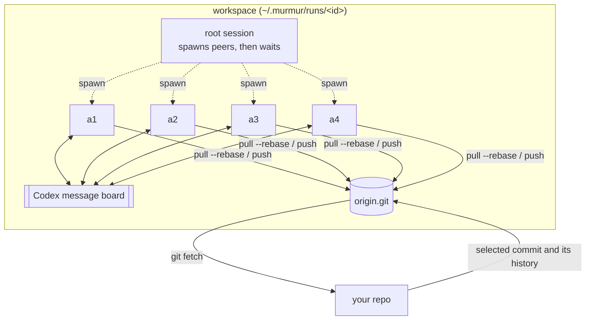

# murmur

Run a leaderless swarm of [Codex](https://github.com/openai/codex) agents on one objective.

`murmur` gives N Codex agents the same brief and the same authority. They share a private git
remote and Codex's built-in message board, divide the work among themselves, and integrate through
git. No agent is in charge. The launcher, not a peer, checks that every peer attested the same
final commit. You get the result as a branch to review.

```bash
murmur setup brief.md --repo . --peers 4 --setup "npm ci"
murmur run ~/.murmur/runs/3f9a1c2e
git fetch ~/.murmur/runs/3f9a1c2e/work/origin.git main:murmur/3f9a1c2e
```

## How it works



`murmur setup` fetches the selected commit, and the history reachable from it, into a bare
`origin.git` and makes a clone per agent. It runs your setup commands once in the first clone,
then copy-on-write clones that tree for the other agents. It renders a prompt per agent: your
brief, shared rules, and that agent's identity and port range.

`murmur run` starts one `codex exec` session. Its root only spawns the peers through Codex's
Multi-Agent V2 tools and waits for them. The peers work in four moves:

1. **Shared tools:** one peer builds a way to run and capture the result without credentials.
2. **Explore:** each peer claims a different direction for the parts that decide quality and
   builds a quick draft of it on `draft/<id>`, without looking at the others first. Peers of one
   model with one brief think alike; separate drafts give the swarm real alternatives, which a
   single agent never has.
3. **Choose by looking:** every peer captures every draft and ranks them; the draft ranked first
   most often becomes the base.
4. **Build and review:** the peers plan the whole result in `PR.md`, claim parts on the message
   board (by convention a `tasks` channel where the earliest claim wins, and a `findings`
   channel) and push to `main`. Each peer attests the current `origin/main` commit, with the
   acceptance checks it ran. A later push voids earlier attestations.

The root retries a failed spawn at most twice. `done` from the root only means no peer is still
running. The launcher then checks the attestations. The run is successful only when every expected
peer attested that same commit and every recorded check passed. Otherwise `murmur run` exits
non-zero and still prints the fetch command when `origin.git` exists.

`murmur setup --solo` builds the same isolated workspace for a single agent, as a baseline. A solo
run does not use the peer attestation protocol.

## Install

Requires Python 3.11+, git, and Codex CLI 0.162 or later, logged in.

```bash
uv tool install --editable .   # or: pipx install .
```

## Usage

```text
murmur setup BRIEF [--repo DIR] [--base REF] [--peers N | --solo] [--setup CMD]...
                   [--setup-per-agent] [--setup-env VAR]...
                   [--model M] [--effort E] [--cap 3h] [--port-base N]
                   [--into DIR] [--id ID] [--config FILE]
murmur run WORKSPACE [--recover] [--retry] [--protocol-retries N]
```

| Option | Default | Notes |
|--------|---------|-------|
| `BRIEF` | — | Markdown with the objective. The agents cannot ask questions; they record their decisions in `PR.md`. |
| `--repo` | current repo | Agents start from one commit and the history reachable from it; uncommitted changes are not included |
| `--base` | `HEAD` | Commit or ref to start from |
| `--peers` / `--solo` | 4 peers | Two peers are often as good as four |
| `--setup` | none | Shell command run before the clock starts (repeatable). By default it runs once, in the first clone |
| `--setup-per-agent` | off | Run those commands in every clone. Use this when the install embeds absolute paths (Python venvs, node shebangs, compiled prefixes) |
| `--setup-env` | none | Host variable name to pass through to setup commands. Repeatable. Config: `setup_env = ["NPM_TOKEN"]` |
| `--cap` | `3h` | Hard time limit, e.g. `90m` |
| `--port-base` | `40000` | Each agent gets 100 ports, injected into shells started in its clone as `PORT_BASE` |
| `--config` | none | TOML. Flags override it. `setup_per_agent = true` matches the flag. `agent_env` templates may use `$agent`, `$index`, `$port_base`, `$run` |
| `--recover` | | Close a stale `running` attempt (and stop a leftover Codex process) and start another |
| `--retry` | | Start another attempt after a finished run. Logs from the earlier attempt stay |
| `--protocol-retries` | `0` | Extra Codex sessions if a swarm exits 0 with an incomplete protocol. Each one spawns the peers again and counts against the same cap |

`murmur run` prints how long the run took, how many commits it made, and the `git fetch` command.
On any non-zero exit it also prints a short diagnostic and the log path. `PR.md` at the root of
the result is the agents' summary.

### Exit status

| Code | Meaning |
|------|---------|
| 0 | Solo Codex exited 0, or every peer attested the current `origin/main` with passing checks |
| 1 | Codex exited non-zero |
| 2 | The time cap was reached |
| 3 | Launcher error: bad arguments, setup command failed, lock held, stale run, unsupported state |
| 4 | Codex exited 0 but the completion protocol is incomplete |
| 130 | Interrupted (`SIGINT` / `SIGTERM` / `SIGHUP`) |

Argparse usage errors still exit 2. A failed or capped run keeps the fetch command whenever
`origin.git` is there. `partial result, not a completed run` means the workspace has commits or a
final message and the protocol did not succeed.

### Copy-on-write setup

Setup runs the `--setup` commands in the first clone, then copies that tree for each other agent:

- macOS: `cp -c -R` (APFS clonefile)
- Linux: `cp --reflink=always -R` (btrfs or xfs)

The copy is never retried as a plain `cp`. If reflink fails, murmur deletes the partial tree,
keeps the first clone, and runs setup in the remaining clones in parallel, with the same shared
environment as the first clone. Each copy's git `user.name`, `user.email`, origin URL, and any
config value that still points at the first clone are rewritten.

Shared setup does not receive per-agent `PORT_BASE` or `agent_env`, so those values are not baked
into a tree that is then copied. Shells that start inside a clone load `.murmur/env.sh`, which
exports that agent's ports and `agent_env`. `bin/murmur-sh` does the same for one command.

`--setup-per-agent` (or `setup_per_agent = true`) is the escape hatch when setup output contains
absolute paths, such as a virtualenv or a `node_modules` tree whose shebangs point at the first
clone. Those commands then run in every clone and do see that agent's environment.

Unless the repo's `.npmrc` already sets `store-dir` to a path inside the workspace, setup and
agent shells set `npm_config_store_dir` to `<workspace>/pnpm-store`. That store is deleted with
the workspace. Murmur does not give the install write access to the user's global pnpm store.

### Run state

A workspace is locked for the duration of `murmur run`. A second run exits 3 while the lock is
held. State lives in `logs/state.json` (`version`, then `ready`, `running`, `succeeded`,
`failed`, `capped`, or `interrupted`) and is written atomically. The running record includes the
launcher pid, the Codex pid, the host, and an attempt id.

Each attempt's logs are `logs/attempts/<id>/` (`session.jsonl`, `session.err`, `record.json`).
A later attempt does not truncate them. `logs/run.json` is only the latest summary.

If the launcher dies and leaves `running` behind, the next `murmur run` refuses to start. When
the Codex process is still alive it says so and does not kill it. `murmur run --recover` stops
that process group when the recorded process is still the one murmur started, marks the attempt
`failed` with reason `stale`, and starts a new attempt.

On the way out, including success, failure, the cap, interruption, and an unexpected exception,
murmur signals the Codex process group: `SIGTERM`, then `SIGKILL` if any member is still alive
after the grace period.

### Completion protocol

Expected peers come from `murmur.json`. After the session each peer is one of:

| Status | Meaning |
|--------|---------|
| `spawn-failed` | No attestation for this attempt (the peer never started, or the file is from another attempt) |
| `blocked` | The peer wrote `started` or `blocked` and never finished |
| `failed` | The peer wrote `failed`, a check failed, or the attested commit is not current `origin/main` |
| `completed` | The attestation names current `origin/main` and every check passed |

A push after an attestation makes that attestation `failed` until the peer attests the new
commit. Agents stay equal: the launcher checks the files, and no peer can accept the result for
the others. The root's in-session spawn retries are capped at two extra attempts per peer.
`--protocol-retries N` opts into N extra Codex sessions when the process exited 0 and the
protocol is still incomplete.

## Isolation

What murmur enforces:

- Each agent works in its own clone. The only remote is the workspace's `origin.git`.
  Force-pushes and branch deletions are refused.
- Agent shells get Codex's `core` environment, not the full host environment.
  `shell_environment_policy.ignore_default_excludes=false` drops variable names containing
  `KEY`, `SECRET`, or `TOKEN`. `experimental_use_profile=false` tells Codex not to source the
  user shell profile.
- `HOME` for those shells is `<workspace>/home`, `ZDOTDIR` is `<workspace>/shell`, and `BASH_ENV`
  and `ENV` point at a workspace script. Login bash, non-interactive bash, and zsh therefore
  source murmur's startup files instead of `~/.bashrc`, `~/.bash_profile`, or `~/.zshrc`. Those
  files load the clone's `.murmur/env.sh` when the working directory is inside the workspace.
- Setup commands run with `sh -c` and an allowlist: `PATH`, `HOME`, `USER`, `LOGNAME`, `LANG`,
  `LC_ALL`, `LC_CTYPE`, `TMPDIR`, `TERM`, plus the git and pnpm variables above. Anything else
  from the host environment is included only if named with `--setup-env` or `setup_env`.
- GitHub git URLs are rewritten to `file:///nonexistent/github-is-blocked/` for `https`, `http`,
  `git://`, `ssh://`, and `git@github.com:` forms (including `www` and an ssh port). The git
  config has no credential helper. `GH_CONFIG_DIR` is an empty directory, so `gh` is not logged in.

What this is not:

- It is not a network block. Codex still runs with `sandbox_workspace_write.network_access=true`.
  `curl https://github.com` can succeed. The rewrite only stops git from using those URL prefixes.
- The Codex process itself still receives the launcher's environment so Codex can start. The
  shell policy above applies to commands the agents run.
- A command that reads a credential file by absolute path can still do so. The Codex sandbox can
  read the disk. For strict isolation, run murmur as a separate OS user.

## Workarounds murmur applies to Codex 0.162

- **`--disable multi_agent` does not remove `spawn_agent` for models whose catalog entry forces
  Multi-Agent V2** ([openai/codex#50880](https://github.com/openai/codex/issues/50880)). For
  `--solo`, murmur writes a per-run model catalog with `multi_agent_version` cleared.
- **Sub-agents run at the catalog's `multi_agent_reasoning_effort`** (`xhigh` for `gpt-6-astra`),
  not at the session's. The per-run catalog pins it to `--effort`.
- **Multi-Agent V2 allows 4 threads per session, counting the root**, so a fourth peer fails to
  spawn. murmur raises the limit to peers + 1.
- Sessions start in the workspace's `work/` directory, which is not a repository. That needs
  `--skip-git-repo-check`, and it keeps the repo's own Codex hooks from loading. The shared
  prompt sends every agent to its clone's `AGENTS.md`.

## Tests

Tests use a fake `codex` executable and temporary git repositories. They do not call a model.

```bash
python -m pip install -e ".[test]"
pytest
```

Continuous integration builds the wheel, installs it in a clean virtualenv, checks the `murmur`
entry point and the packaged prompts, then runs the same suite.

## What we have measured

One pilot so far: a customer-facing UI feature in a large TypeScript monorepo, 4 peers versus one
agent, the same model and brief.

| | Swarm (4 peers) | Solo |
|---|---|---|
| Time to done | 46 min | 120 min |
| Uncached input / output tokens | 1.5M / 0.13M | 0.9M / 0.11M |
| Review | Native look, safer integration, plainer UI, weak mobile layout | Richer UI and motion, one unreachable state, a risky product change |

The swarm was 2.6× faster; the single agent's result was narrowly better. One run each is a
first read, not a conclusion.

## Status

Experimental. It depends on Codex features that are still marked under development (the agent
message board) and on behaviour of Codex 0.162.
